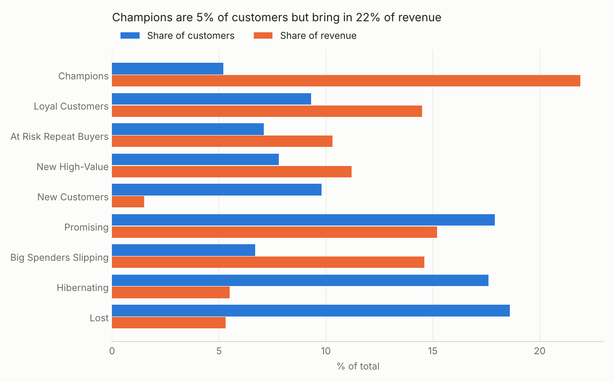
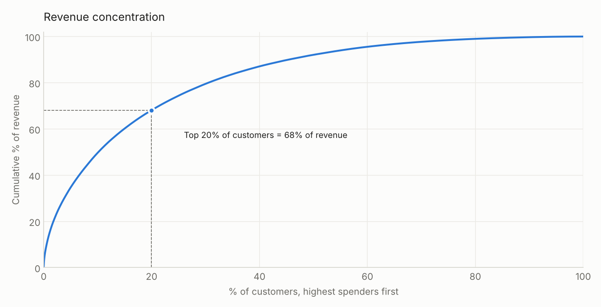
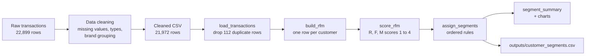

# Customer Segmentation with RFM Analysis

Segments **12,926 customers** of an online electronics store into nine actionable groups using Recency, Frequency and Monetary (RFM) analysis, then shows where revenue is concentrated and which customers are worth winning back.

The pipeline is a tested Python module (`src/rfm.py`) with a command-line entry point, a notebook that tells the story with charts, and a one-row-per-customer export that can feed a CRM or BI dashboard.


---

## Key findings

| | |
|---|---|
| **Data** | 21,860 line items · 17,934 orders · 12,926 customers · 24 Apr to 11 Jun 2020 |
| **One-time buyers** | 78% of customers placed a single order |
| **Revenue concentration** | The top 20% of customers generate **68%** of revenue |
| **Champions** | **5%** of customers bring in **22%** of revenue (avg 4.9 orders, 1,266 spend) |
| **Champions + Loyal** | 14.5% of customers, 36.4% of revenue |
| **Biggest win-back opportunity** | 863 one-time customers averaging **656** spend (2.2× the average customer), silent for about 33 days: **14.6% of revenue** |
| **Low-value tail** | Hibernating + Lost are 36% of customers but only 11% of revenue |





### What the business should do

| Segment | Customers | Revenue share | Recommended action |
|---|---:|---:|---|
| Champions | 668 | 21.9% | VIP treatment, early access, referral programme |
| Loyal Customers | 1,207 | 14.5% | Loyalty rewards to move them to a third order |
| At Risk Repeat Buyers | 915 | 10.3% | Personal win-back offer before they lapse |
| New High-Value | 1,004 | 11.2% | Onboarding plus accessories cross-sell |
| New Customers | 1,272 | 1.5% | Welcome series, second-purchase incentive |
| Promising | 2,312 | 15.2% | Recommendations based on first purchase |
| Big Spenders Slipping | 863 | 14.6% | Highest-priority reactivation campaign |
| Hibernating | 2,281 | 5.5% | Low-cost automated reminders |
| Lost | 2,404 | 5.3% | Exclude from paid campaigns |

*Amounts are in the dataset's currency. Revenue = sum of line-item prices.*

---

## Pipeline



## Method

**RFM per customer (`user_id`):**

| Metric | Definition |
|---|---|
| Recency | Days from the customer's last purchase to the day after the last transaction in the data |
| Frequency | Number of **distinct orders** (an order with three items counts once) |
| Monetary | Total spend across all orders |

**Scoring (1 = worst, 4 = best):**
- R and M are scored by quartile. Values are ranked before binning so ties never collapse a quartile.
- F uses fixed cut-offs (1, 2, 3, 4+ orders). With 78% of customers on one order, frequency quartiles would put almost everyone in the same bin.

**Segmentation:** nine rules in `SEGMENT_RULES`, checked in order. The first match wins, so every customer belongs to exactly one segment. A unit test enforces this.

### Design decisions

| Decision | Why |
|---|---|
| Rules instead of clustering | Each segment has a plain-English definition marketing can act on, and results are reproducible |
| Fixed cut-offs for frequency | Matches the real distribution of order counts |
| Logic in a module, notebook only for presentation | The same code runs in tests, the CLI and the notebook |
| Duplicates removed at load time | 112 identical rows would otherwise inflate spend |

### Methodology note (v2)

The original notebook (`RFM_Analysis_Customer_Segmentation (1).ipynb`) grouped RFM by **`product_id`**, which measures products rather than customers, so 2,787 customers ended up in more than one segment. Its frequency quartiles also had only three labels, which made the top "Platinum Customer" tier impossible to reach. Version 2 recomputes everything per customer in `src/rfm.py`. The original notebooks are kept for reference.

---

## Project structure

```
customer-segmentation-rfm-analysis/
├── src/
│   └── rfm.py                                    # load, RFM, scoring, segmentation, summary, CLI
├── tests/
│   └── test_rfm.py                               # unit tests (pytest)
├── notebooks/
│   └── rfm_customer_segmentation.ipynb           # v2 analysis with charts
├── images/                                       # charts used in this README
├── outputs/                                      # customer_segments.csv, segment_summary.csv
├── Data_Cleaning_(1) (1).ipynb                   # original cleaning notebook
├── RFM_Analysis_Customer_Segmentation (1).ipynb  # original (v1) analysis
├── Transaction_Cleaned_Data (1).csv              # cleaned transactions
├── Customer_Trans_RFM_Analysis (1).csv           # v1 output
├── .github/workflows/tests.yml                   # runs the tests on every push
└── requirements.txt
```

## Run it

```bash
git clone https://github.com/Ad1ba19/customer-segmentation-rfm-analysis.git
cd customer-segmentation-rfm-analysis
python -m venv .venv && source .venv/bin/activate
pip install -r requirements.txt

# segment every customer and print the summary
python -m src.rfm "Transaction_Cleaned_Data (1).csv" --out outputs/customer_segments.csv

# run the tests
python -m pytest -q

# open the analysis notebook
jupyter notebook notebooks/rfm_customer_segmentation.ipynb
```

## Limitations and next steps

- **Short window:** the data covers seven weeks, so recency ranges only from 0 to 48 days. A longer history would separate "lapsed" from "between purchases" more reliably.
- **Revenue is item price:** there is no quantity, discount or refund column, so spend may be overstated where an item was returned.
- **No outcome data:** the segments are descriptive. The next step is to test them against later behaviour, for example whether "Big Spenders Slipping" buy again after a campaign.
- **Batch only:** the next step is to schedule the CLI (for example with Airflow or a cron job) and write segments to a database table instead of a CSV.
- **Clustering comparison:** compare the rule-based segments with K-means on scaled R, F and M, and keep it only if it gives more actionable groups.

## Tech stack

Python · pandas · NumPy · Matplotlib · Seaborn · scikit-learn (cleaning) · pytest · GitHub Actions · Jupyter

---

## Author

**Adiba Khan** · Software Engineer · Backend & Microservices · GenAI Systems

[](https://github.com/Ad1ba19)
[](https://www.linkedin.com/in/adiba-khan-20ba57230/)
